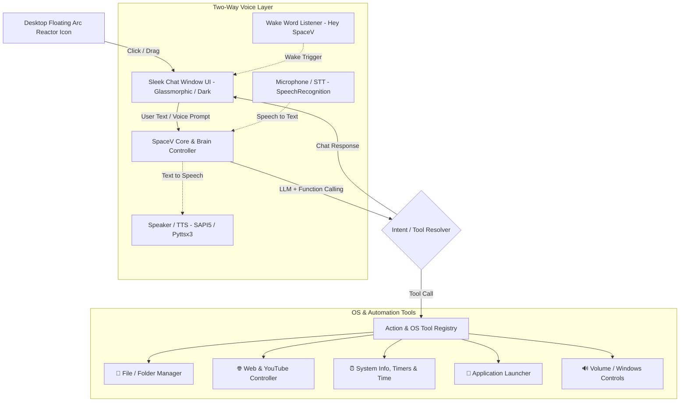

# Windows Desktop AI Agent ("SpaceV") — Implementation Blueprint

A comprehensive blueprint for **SpaceV** (*System Protocol Autonomous Cybernetic Engine Version V*), a **floating, draggable Windows desktop AI Agent**. The agent starts as a sleek cybernetic Arc Reactor bubble that expands into a conversational command center capable of controlling Windows (file management, browser search, playing YouTube, system controls, timers, media keys) with continuous hands-free wake-word detection and two-way voice.

---

## 1. Architecture Overview



---

## 2. How SpaceV Works:

1. **Pre-trained Brain**: We use established foundation models (like **Google Gemini**, **OpenAI**, or local **Ollama / Llama 3**) that already understand human language, logic, and reasoning.
2. **Function Calling (Tool Calling)**: 
   - We give the AI a list of Python "Tools" (e.g., `create_folder`, `open_browser`, `play_youtube`, `get_time`).
   - When you tell the agent: *"Create a folder named Projects on my Desktop"*, the AI automatically understands the intent and outputs a structured command:
     `{"tool": "create_folder", "arguments": {"name": "Projects", "location": "Desktop"}}`
   - Your local Python application executes that command directly on Windows and gives a confirmation back to the AI.
3. **Your LLM Choices**:
   - **Cloud (Recommended & Super Fast)**: **Google Gemini API** (generous free tier, ultra-fast response, top-tier function calling).
   - **Local / Offline (100% Private)**: **Ollama** running `Llama 3.2` or `Qwen 2.5` locally on your PC hardware without needing internet.

---

## 3. Project Structure

```text
d:\agentSpace\
├── main.py                  # Entry point (initializes app & tray icon)
├── config.py                # App settings, API keys, window positions
├── requirements.txt         # Dependencies (PyQt6, google-genai, etc.)
│
├── ui/                      # User Interface Components
│   ├── __init__.py
│   ├── floating_icon.py     # Draggable, always-on-top circular bubble
│   ├── chat_window.py       # Modern chat popup with message bubbles & inputs
│   └── styles.py            # QSS / Glassmorphic dark styling & animations
│
├── core/                    # Core Agent Logic
│   ├── __init__.py
│   ├── agent.py             # Brain controller: prompts LLM & dispatches tools
│   ├── llm_client.py        # Gemini / Ollama client wrapper
│   └── memory.py            # Chat history & conversation state
│
├── tools/                   # OS & Automation Tool Registry
│   ├── __init__.py
│   ├── registry.py          # Tool schema definitions & execution router
│   ├── file_tools.py        # Folder creation, listing, file operations
│   ├── web_tools.py         # Google search, YouTube playback, URL opener
│   ├── system_tools.py      # Current time, system stats, app launcher
│   └── media_tools.py       # Volume control, screenshot, lock screen
│
└── voice/                   # (Phase 2) Voice Integration Module
    ├── __init__.py
    ├── stt.py               # Speech-to-text listener (Whisper / SpeechRec)
    └── tts.py               # Text-to-speech speaker (Edge-TTS / pyttsx3)
```

---

## 4. Step-by-Step Implementation Roadmap

### Step 1: Floating Desktop UI (PyQt6)
- Create a frameless, transparent, always-on-top floating circular icon.
- Add mouse drag-and-drop movement anywhere on the screen.
- Clicking the bubble smoothly pops up a dark-mode / glassmorphism chat panel.

### Step 2: OS & Action Tools (Python Automation)
- **File System**: Create directories, open folders, create files.
- **Web & Media**: Search Google, play YouTube videos in Chrome/default browser, open URLs.
- **System Utilities**: Fetch system time & date, launch Windows apps (Calculator, Notepad, VS Code, etc.), adjust volume, take screenshots.

### Step 3: AI Brain & Function Calling
- Connect the LLM with structured function definitions.
- Implement background threading (`QThread`) so the UI stays responsive and never freezes while processing actions.

### Step 4: Polish & Tray Integration
- Windows system tray icon (Run in background, hide/show, quit).
- Shortcut hotkeys (e.g. `Ctrl + Space` or `Win + Shift + J`).

### Step 5: Voice Upgrade (Phase 2)
- Add speech recognition (microphone input via Whisper) and voice output (Text-to-Speech via Edge-TTS).
