# SpaceV: Full-to-End Flowchart Architecture Specification

This document provides the complete, un-truncated visual flowchart architecture comparing **Current SpaceV (Failure Flow)** against **Upgraded SpaceV (Success Flow)** when provided with an issue search and reproduction prompt.

---

## 1. Unified Side-by-Side Flowchart Architecture

Both workflows run in parallel columns from top to bottom, directly comparing each execution stage:

```mermaid
flowchart TD
    %% Common User Input
    Input(["📥 User Input:<br/>'Find issues specifically for testing your agent...<br/>github.com/issues?q=is:issue+is:open+label:bug+reproduction...'"])

    %% Top Level Split
    Input --> C1["🔴 CURRENT SpaceV<br/>Stage 1: Goal Interpreter Node<br/>core/graph_engine.py:476"]
    Input --> U1["🟢 UPGRADED SpaceV<br/>Stage 1: Fast Intent Router (0ms)<br/>core/fast_router.py:170"]

    %% Step 2: Detection
    C1 --> C2{"Regex Check:<br/>re.search('/(issues|pull)/')<br/>Matches /issues?q=...?"}
    U1 --> U2{"Fast Regex Detection:<br/>github.com/issues?q=..."}

    %% Step 3: Routing
    C2 -- "❌ No (/issues? != /issues/)" --> C3["parsed_issue = None<br/>Falls through to Conversational Swarm"]
    U2 -- "⚡ Match Found" --> U3["Stage 2: Issue Discovery Engine<br/>tools/resilient_github_fetch.py"]

    %% Step 4: Role & Ingestion
    C3 --> C4["Stage 2: Swarm Role Classifier<br/>core/swarm_orchestrator.py:84"]
    U3 --> U4["Dual-Channel GitHub Search<br/>REST API + BeautifulSoup HTML Scraper<br/>Query: 'is:issue is:open label:bug reproduction'"]

    %% Step 5: Classification
    C4 --> C5{"Matches 'test' in<br/>'testing your agent'?"}
    U4 --> U5["Stage 3: Candidate Issue Ranking<br/>1. psf/requests#7639 (Score: 98% - Timeout Bug)<br/>2. pallets/flask#5123 (Score: 91% - Routing Bug)<br/>3. urllib3/urllib3#3201 (Score: 87% - Pool Leak)"]

    %% Step 6: Tool Scoping vs Issue Selection
    C5 -- "⚠️ Misclassified" --> C6["Assigned Role:<br/>AgentRole.AUDITOR (Local Code Auditor)"]
    U5 --> U6["Auto-select or User picks:<br/>psf/requests/issues/7639"]

    %% Step 7: Tool Stripping vs Pipeline Handoff
    C6 --> C7["Stage 3: Tool Allowlist Scoping<br/>core/agent_configs.py:180"]
    U6 --> U7["Stage 4: Deterministic Pipeline Compiler<br/>core/autonomous_issue_pipeline.py"]

    %% Step 8: Lockout vs Sandbox Provisioning
    C7 --> C8["🚫 WEB TOOLS STRIPPED!<br/>read_web_page & search_web removed.<br/>Only local tools (read_file, run_tests) remain."]
    U7 --> U8["Celesto Ubuntu Sandbox Provisioning<br/>Ubuntu 22.04 LTS (Git & Pytest pre-installed)<br/>Shallow clone with 180s adaptive timeout"]

    %% Step 9: Dispatch vs Baseline & Test
    C8 --> C9["Stage 4: Model Tool Dispatch<br/>core/cloud_client.py"]
    U8 --> U9["Automated Baseline & Test Synthesis<br/>1. pytest tests/ passes clean (C_base = 0)<br/>2. Scoped LLM diff in tests/test_repro.py<br/>3. Candidate pytest fails with bug symptom (C_cand = 1)"]

    %% Step 10: Terminal States
    C9 --> C10["❌ TERMINAL FAILURE / STALL<br/>Model receives web search link<br/>with ZERO web tools in schema.<br/>Emits 'I cannot browse web' or hallucinates.<br/>Pipeline NEVER starts."]
    U9 --> U10["✅ TERMINAL SUCCESS: VERIFIED REPRODUCTION<br/>Empirical causal verification complete.<br/>SHA-256 signed evidence bundle exported.<br/>Celesto MicroVM cleanly destroyed in finally: block."]

    %% Styling
    classDef err fill:#b71c1c,stroke:#ff8a80,stroke-width:2px,color:#ffffff;
    classDef ok fill:#1b5e20,stroke:#b9f6ca,stroke-width:2px,color:#ffffff;
    classDef warn fill:#e65100,stroke:#ffd180,stroke-width:2px,color:#ffffff;
    classDef blue fill:#0d47a1,stroke:#82b1ff,stroke-width:2px,color:#ffffff;
    classDef inp fill:#37474f,stroke:#cfd8dc,stroke-width:2px,color:#ffffff;

    class Input inp;
    class C8,C10 err;
    class C2,C5,C6 warn;
    class U10 ok;
    class C1,C3,C4,C7,C9,U1,U2,U3,U4,U5,U6,U7,U8,U9 blue;
```

---

## 2. Full-to-End UPGRADED Architecture Flowchart

```mermaid
flowchart TD
    Start(["📥 User Prompt:<br/>'Find issues specifically for testing your agent...<br/>https://github.com/issues?q=is:issue+is:open+label:bug+reproduction...'"])

    Start --> FastRouter["1. FastRouter (0ms Regex Dispatch)<br/>core/fast_router.py:170"]
    
    FastRouter --> QueryDetect{"Detects Search Query:<br/>github.com/issues?q=..."}

    QueryDetect --> DiscoveryEngine["2. Issue Discovery Engine<br/>tools/resilient_github_fetch.py"]

    DiscoveryEngine --> DualFetch["Dual-Channel GitHub Search<br/>1. Authenticated REST API (primary)<br/>2. BeautifulSoup HTML Scraper (fallback on 403)"]

    DualFetch --> Ranking["3. Candidate Issue Ranking & Filtering<br/>Filters issues with verified reproduction steps:<br/>• Candidate 1: psf/requests/issues/7639 (Score: 98%)<br/>• Candidate 2: pallets/flask/issues/5123 (Score: 91%)<br/>• Candidate 3: urllib3/urllib3/issues/3201 (Score: 87%)"]

    Ranking --> Selection["Issue Target Confirmed:<br/>https://github.com/psf/requests/issues/7639"]

    Selection --> Pipeline["4. AutonomousIssuePipeline Controller<br/>core/autonomous_issue_pipeline.py"]

    subgraph PipelineExecution ["Deterministic 7-Stage State Machine (Zero LLM Chat Turns)"]
        direction TB
        
        S1["Stage 1: Normalize Target URL<br/>canonical_url: https://github.com/psf/requests/issues/7639<br/>repo: psf/requests, issue_number: 7639"]
        
        S1 --> S2["Stage 2: Ingest Issue Text & Ground Expected Signal<br/>Extracts title, body, and signal: 'TimeoutExpired'<br/>Stores raw receipt in TaskEvidenceStore"]
        
        S2 --> S3["Stage 3: Provision Isolated Celesto Sandbox<br/>Boots Ubuntu 22.04 LTS MicroVM with Git & Pytest<br/>UUID Naming: sbx-repro-{uuid.hex}<br/>Executes shallow clone: git clone --depth 1 (180s timeout)"]
        
        S3 --> S4["Stage 4: Commit Pinning & Clean Baseline Pass<br/>Pin commit: git rev-parse HEAD<br/>Verify clean worktree: git status --porcelain<br/>Run baseline control test: pytest tests/ -q (Must Exit 0)<br/>Assert C_base == 0"]
        
        S4 --> S5["Stage 5: Minimal Test Synthesis Kernel (Scoped LLM)<br/>System prompts model: Output unified diff strictly in tests/<br/>Generates: tests/test_repro_issue_7639.py<br/>AST Boundary Audit: Zero production file edits allowed"]
        
        S5 --> S6["Stage 6: Apply Patch & Execute Candidate Test<br/>Apply diff: git apply patch.diff<br/>Audit worktree: git status --short (TEST_FILES_ONLY)<br/>Run candidate test: pytest tests/test_repro_issue_7639.py -v<br/>Causal Verification: Assert C_cand == 1 and 'TimeoutExpired' in stdout"]
        
        S6 --> S7["Stage 7: SHA-256 Packaging & Guaranteed Teardown<br/>Hash commit, diff, and stdout receipts into JSON bundle<br/>Export bundle to reports/evidence/<br/>MicroVM destroyed via Python async with __aexit__"]
    end

    Pipeline --> PipelineExecution
    
    PipelineExecution --> Report(["✅ Final Verified Markdown Report Rendered in <3 Minutes<br/>Verdict: VERIFIED_BUG_REPRODUCTION<br/>SHA-256 Signed Evidence Bundle Ready"])

    classDef ok fill:#1b5e20,stroke:#b9f6ca,stroke-width:2px,color:#ffffff;
    classDef blue fill:#0d47a1,stroke:#82b1ff,stroke-width:2px,color:#ffffff;
    classDef head fill:#37474f,stroke:#cfd8dc,stroke-width:2px,color:#ffffff;

    class Start,Report head;
    class FastRouter,QueryDetect,DiscoveryEngine,DualFetch,Ranking,Selection,Pipeline,S1,S2,S3,S4,S5,S6,S7 blue;
    class Report ok;
```

---

## 3. Full-to-End CURRENT Architecture Flowchart (Failure Points)

```mermaid
flowchart TD
    Start(["📥 User Prompt:<br/>'Find issues specifically for testing your agent...<br/>https://github.com/issues?q=is:issue+is:open+label:bug+reproduction...'"])

    Start --> GraphEngine["1. SpaceVGraphEngine._goal_interpreter_node()<br/>core/graph_engine.py:430"]

    GraphEngine --> TemplateCheck{"Template Marker Check:<br/>unresolved_template_marker()"}

    TemplateCheck -- "Pass" --> RegexCheck{"Issue Link Regex:<br/>re.search('/(issues|pull)/', url)"}

    RegexCheck -- "❌ Fails: URL has /issues?q=, not /issues/" --> Miss["parsed_issue remains None<br/>Fails to extract owner/repo/number"]

    Miss --> Swarm["2. SwarmOrchestrator.classify_agent_role()<br/>core/swarm_orchestrator.py:84"]

    Swarm --> Heuristics{"Role Regex Heuristics:<br/>1. '/issues/' in url? &rarr; False<br/>2. 'reproduce the issue'? &rarr; False<br/>3. 'test' in text? &rarr; Matches 'testing your agent'"}

    Heuristics -- "⚠️ Misclassified" --> AuditorRole["Assigned Role:<br/>AgentRole.AUDITOR (Local Test Auditor)<br/>core/agent_configs.py:168"]

    AuditorRole --> Allowlist["3. Tool Scoping Gate<br/>core/agent_configs.py:180<br/>Allows only: read_file, search_file, run_tests"]

    Allowlist --> Lockout["🚫 WEB TOOLS STRIPPED FROM SCHEMA!<br/>read_web_page & search_web are REMOVED"]

    Lockout --> LLMDispatch["4. LLM Model Reasoning Node<br/>core/cloud_client.py"]

    LLMDispatch --> DeadEnd{"Model analyzes prompt:<br/>Contains web search link<br/>but has ZERO web tools"}

    DeadEnd --> Crash["❌ TERMINAL FAILURE / STALL:<br/>1. LLM emits: 'I cannot browse the web or access external URLs.'<br/>2. Or hallucinates local workspace test files.<br/>3. Celesto sandbox NEVER provisions.<br/>4. Autonomous reproduction pipeline NEVER executes."]

    classDef err fill:#b71c1c,stroke:#ff8a80,stroke-width:2px,color:#ffffff;
    classDef warn fill:#e65100,stroke:#ffd180,stroke-width:2px,color:#ffffff;
    classDef blue fill:#0d47a1,stroke:#82b1ff,stroke-width:2px,color:#ffffff;
    classDef head fill:#37474f,stroke:#cfd8dc,stroke-width:2px,color:#ffffff;

    class Start head;
    class GraphEngine,TemplateCheck,Swarm,AuditorRole,Allowlist,LLMDispatch blue;
    class RegexCheck,Heuristics,Miss,Lockout,DeadEnd warn;
    class Crash err;
```

